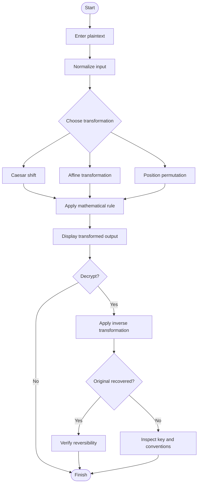
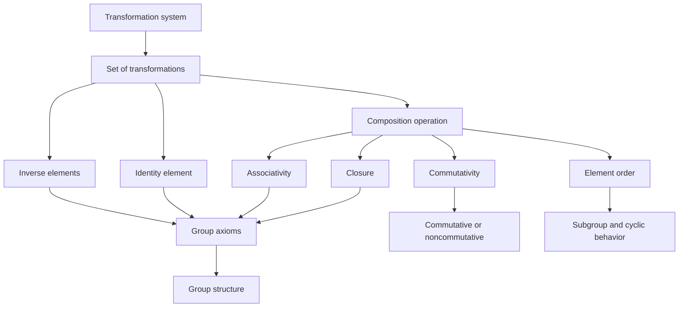
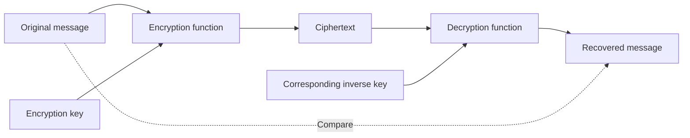
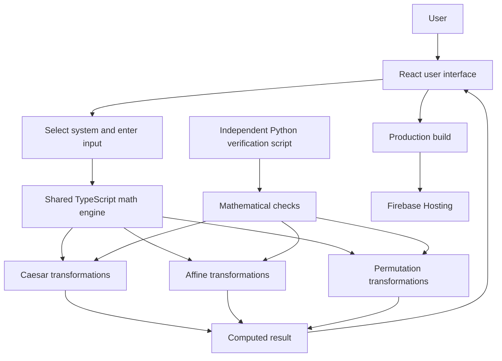
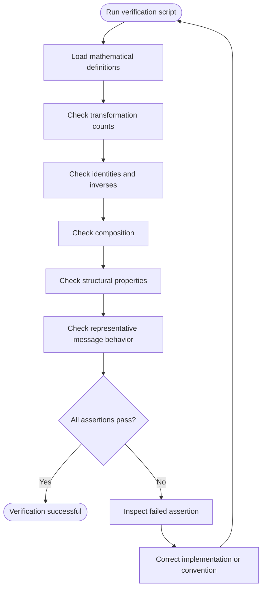

# NOETIC — Abstract Algebra Lab

<p align="center">
  
</p>

<h1 align="center">NOETIC</h1>

<p align="center">
  <strong>REVERSIBILITY IS STRUCTURE.</strong>
</p>

<p align="center">
  An interactive exploration of abstract algebra, reversible transformations, and the mathematical foundations of classical cryptography.
</p>

<p align="center">
  <a href="https://abstract-algebra-lab.web.app/">
    
  </a>
  <a href="https://abstract-algebra-lab.web.app/documents/research-paper.pdf">
    
  </a>
</p>

<p align="center">
  
  
  
  
  
</p>

---

## Table of Contents

- [1. Introduction](#1-introduction)
- [2. Research Objectives](#2-research-objectives)
- [3. Explore the Application](#3-explore-the-application)
- [4. Mathematical Foundations](#4-mathematical-foundations)
- [5. Comparing the Three Systems](#5-comparing-the-three-systems)
- [6. Mathematical Diagrams](#6-mathematical-diagrams)
- [7. Application Features](#7-application-features)
- [8. Technology Stack](#8-technology-stack)
- [9. Getting Started](#9-getting-started)
- [10. Mathematical Verification](#10-mathematical-verification)
- [11. Project Structure](#11-project-structure)
- [12. Mathematical Conventions](#12-mathematical-conventions)
- [13. Research Paper](#13-research-paper)
- [14. Security Disclaimer](#14-security-disclaimer)
- [15. Contributors](#15-contributors)

---

## 1. Introduction

**NOETIC — Abstract Algebra Lab** is an interactive educational project exploring the relationship between abstract algebra and classical cryptographic transformations.

Abstract algebra studies mathematical structures such as groups, rings, and fields. These structures provide a framework for understanding operations, identity elements, inverses, composition, and symmetry.

Classical cryptography provides a setting in which these concepts can be explored. An encryption transformation changes a message, while an appropriate inverse transformation recovers the original message.

This project investigates three systems of reversible transformations:

1. **Caesar transformations** — shifts of letters modulo 26.
2. **Affine transformations** — multiplication and addition modulo 26.
3. **Permutation transformations** — rearrangements of positions in blocks of four symbols.

Although these systems operate differently, they share important mathematical concepts that can be investigated through abstract algebra.

The application combines mathematical definitions, interactive encryption and decryption, structural comparisons, and computational verification.

### The central idea

> Reversibility is more than the ability to undo an operation. It is a mathematical property that connects transformations to algebraic structure.

### Project links

| Resource | Link |
|---|---|
| Live application | [NOETIC — Abstract Algebra Lab](https://abstract-algebra-lab.web.app/) |
| Research paper | [Read the PDF](https://abstract-algebra-lab.web.app/documents/research-paper.pdf) |
| Source code | [GitHub repository](https://github.com/PVSSP656/final-algebra-lab) |

---

## 2. Research Objectives

The project investigates how reversible transformations can be represented and analyzed using concepts from abstract algebra.

### Research questions

- How can classical encryption transformations be represented as mathematical functions?
- What conditions make a transformation invertible?
- How do identity elements and inverse transformations work?
- How does function composition define an algebraic operation?
- Which properties are shared by different transformation systems?
- How can computational experiments verify mathematical results?

### Objectives

1. Represent three transformation systems using precise mathematical definitions.
2. Implement encryption and decryption through a shared calculation layer.
3. Explore identities, inverses, composition, and element order.
4. Compare commutative and noncommutative behavior.
5. Verify mathematical properties using independent computational checks.
6. Present the results through an interactive web application.

### Project scope

The project focuses on the mathematical structure of transformations rather than the practical deployment of cryptographic protocols.

The three systems have different underlying constructions. The fact that all three can transform and restore data does not mean they have identical algebraic structures.

---

## 3. Explore the Application

The application organizes the mathematical investigation into interconnected sections.

| Section | Purpose |
|---|---|
| Overview | Introduces the project and its central mathematical idea. |
| Foundations | Presents the mathematical concepts behind the transformations. |
| Group Explorer | Explores the transformation systems and their elements. |
| The Lab | Provides interactive encryption and decryption experiments. |
| Algebraic Structure | Investigates identities, inverses, composition, and other structural properties. |
| Experiments | Tests mathematical behavior through representative examples. |
| The Team | Presents the project team. |
| Research Log | Presents the research-oriented context of the project. |

**Start exploring:** [Open the live application](https://abstract-algebra-lab.web.app/)

### Application screenshots

#### Overview


#### Mathematical foundations


#### Group explorer


#### Caesar transformation laboratory


#### Affine transformation laboratory


#### Permutation transformation laboratory


#### Algebraic structure


---

## 4. Mathematical Foundations

This section establishes the mathematical definitions used throughout the project.

### 4.1. Modular Arithmetic

Let

$$
\mathbb{Z}_{26}=\{0,1,2,\ldots,25\}.
$$

The set represents the 26 letters of the English alphabet using the encoding

$$
A\leftrightarrow 0,\quad
B\leftrightarrow 1,\quad
\ldots,\quad
Z\leftrightarrow 25.
$$

Arithmetic is performed modulo 26. Two integers are congruent modulo 26 when their difference is divisible by 26.

For example,

$$
29\equiv 3\pmod{26}.
$$

A result outside the range from 0 to 25 can therefore be mapped back into the alphabet using its remainder modulo 26.

Modular arithmetic provides the common numerical foundation for the Caesar and affine systems.

### 4.2. Caesar Transformations

The Caesar system shifts every letter by a fixed amount.

For a key \(k\in\mathbb{Z}_{26}\), define the encryption transformation

$$
E_k(x)=(x+k)\bmod 26.
$$

Here:

- \(x\) is the numerical representation of a letter.
- \(k\) is the shift key.
- \(E_k(x)\) is the encrypted letter.

Decryption subtracts the same shift:

$$
D_k(x)=(x-k)\bmod 26.
$$

Equivalently, the inverse transformation is

$$
E_k^{-1}=E_{(-k)\bmod 26}.
$$

#### Example

Consider the plaintext letter \(C\), represented by 2, and a shift key \(k=3\).

$$
E_3(2)=(2+3)\bmod 26=5.
$$

The numerical value 5 corresponds to \(F\). Therefore, \(C\) is encrypted as \(F\).

Decryption reverses the operation:

$$
D_3(5)=(5-3)\bmod 26=2.
$$

The original letter \(C\) is recovered.

#### Algebraic properties

The Caesar transformations form a cyclic group under composition, isomorphic to the additive group \(\mathbb{Z}_{26}\).

The identity transformation is

$$
E_0(x)=x.
$$

Composition satisfies

$$
E_a\circ E_b=E_{(a+b)\bmod 26}.
$$

The transformations commute:

$$
E_a\circ E_b=E_b\circ E_a.
$$

Every Caesar transformation has an inverse, and the group contains exactly 26 transformations.

### 4.3. Affine Transformations

The affine system combines multiplication and addition modulo 26.

A transformation is defined by

$$
E_{a,b}(x)=(ax+b)\bmod 26.
$$

The parameters are:

- \(a\): the multiplicative key.
- \(b\): the additive offset.
- \(x\): the numerical representation of a letter.

For the transformation to be invertible, \(a\) must have a multiplicative inverse modulo 26. This requires

$$
\gcd(a,26)=1.
$$

The valid multipliers are

$$
a\in\{1,3,5,7,9,11,15,17,19,21,23,25\}.
$$

There are 12 valid multipliers and 26 possible offsets. Consequently, the total number of affine transformations is

$$
12\times 26=312.
$$

#### Deriving the inverse

Starting with

$$
y=ax+b\pmod{26},
$$

subtract \(b\) from both sides:

$$
y-b=ax\pmod{26}.
$$

Since \(a\) is invertible modulo 26, multiply by its modular inverse \(a^{-1}\):

$$
a^{-1}(y-b)=x\pmod{26}.
$$

Therefore, the decryption function is

$$
D_{a,b}(y)=a^{-1}(y-b)\bmod 26.
$$

Equivalently,

$$
D_{a,b}(y)=(a^{-1}y-a^{-1}b)\bmod 26.
$$

#### Example: calculating an inverse key

Consider the affine key \((a,b)=(5,8)\).

Since

$$
5^{-1}\equiv 21\pmod{26},
$$

the inverse multiplier is 21.

The inverse transformation is

$$
D_{5,8}(y)=21(y-8)\bmod 26.
$$

Expanding the expression gives

$$
D_{5,8}(y)=(21y-168)\bmod 26.
$$

Because

$$
-168\equiv 14\pmod{26},
$$

the inverse can be written as

$$
D_{5,8}(y)=(21y+14)\bmod 26.
$$

Thus, the inverse affine key is

$$
(21,14).
$$

#### Composition of affine transformations

Let

$$
f(x)=3x+2\pmod{26}
$$

and

$$
g(x)=5x+7\pmod{26}.
$$

Applying \(g\) first and then \(f\) gives

$$
\begin{aligned}
(f\circ g)(x)
&=f(g(x))\\
&=3(5x+7)+2\\
&=15x+23\pmod{26}.
\end{aligned}
$$

Reversing the order gives

$$
\begin{aligned}
(g\circ f)(x)
&=g(f(x))\\
&=5(3x+2)+7\\
&=15x+17\pmod{26}.
\end{aligned}
$$

Therefore,

$$
f\circ g\ne g\circ f.
$$

This demonstrates that affine transformations are not generally commutative under composition.

The set of invertible affine transformations forms a group of order 312.

### 4.4. Permutation Transformations

A permutation rearranges the positions of elements in a sequence.

The symmetric group \(S_4\) contains all permutations of four positions.

Its order is

$$
|S_4|=4!=24.
$$

For a block of four symbols,

$$
x=(x_0,x_1,x_2,x_3),
$$

a permutation \(p\) produces a transformed block \(y\) according to

$$
y_i=x_{p(i)}.
$$

The permutation specifies which input position supplies the symbol at each output position.

#### Example

Consider the permutation represented using one-based positions as

$$
p=[3,1,4,2].
$$

In the zero-based representation used by the calculation layer, this is

$$
p=(2,0,3,1).
$$

For the input block `ABCD`:

- Output position 0 receives input position 2: `C`.
- Output position 1 receives input position 0: `A`.
- Output position 2 receives input position 3: `D`.
- Output position 3 receives input position 1: `B`.

Therefore,

$$
\texttt{ABCD}\longmapsto\texttt{CADB}.
$$

Applying the inverse permutation restores the original block.

#### Algebraic properties

The permutations of four positions form the symmetric group \(S_4\) under composition.

The group has 24 elements and satisfies closure, associativity, the identity property, and the inverse property.

Unlike the Caesar group, \(S_4\) is noncommutative: the order of two permutations can change the result.

### 4.5. Composition and Inverses

Let \(X\) be a set and let \(f:X\to X\) and \(g:X\to X\) be transformations.

Their composition is defined by

$$
(f\circ g)(x)=f(g(x)).
$$

**Important:** \(g\) is applied first, followed by \(f\).

A transformation \(f\) is invertible if there exists a transformation \(f^{-1}\) such that

$$
f^{-1}\circ f=\operatorname{id}
$$

and

$$
f\circ f^{-1}=\operatorname{id}.
$$

Here, \(\operatorname{id}\) denotes the identity transformation.

These properties allow the transformation to be reversed and the original input to be recovered.

---

## 5. Comparing the Three Systems

| Property | Caesar | Affine | Permutation |
|---|---|---|---|
| Mathematical structure | Cyclic group | Invertible affine transformations | Symmetric group \(S_4\) |
| Underlying domain | \(\mathbb{Z}_{26}\) | \(\mathbb{Z}_{26}\) | Four positions |
| Number of transformations | 26 | 312 | 24 |
| Key representation | Shift \(k\) | Pair \((a,b)\) | Permutation of four positions |
| Invertibility condition | Every shift is invertible | \(\gcd(a,26)=1\) | Every permutation is invertible |
| Identity | Shift by 0 | \(a=1,\ b=0\) | Identity permutation |
| Composition | Addition of shifts modulo 26 | Composition of affine maps | Composition of permutations |
| Commutative? | Yes | Not generally | Not generally |
| Main operation | Letter shifting | Multiplication and shifting | Rearrangement of positions |

### Important distinction

The three systems illustrate related concepts but have different algebraic structures.

- The Caesar transformations form a cyclic group.
- The invertible affine transformations form a larger, noncommutative group.
- The permutations of four positions form the symmetric group \(S_4\).

Comparing them demonstrates how identity, inverses, closure, and composition arise in different mathematical constructions.

---

## 6. Mathematical Diagrams

### 6.1. Transformation Pipeline

This diagram illustrates the general workflow from an input message to a reversible transformation.



### 6.2. Group Structure

The following diagram shows the group-theoretic concepts investigated in the project.



A group is a set equipped with a binary operation satisfying closure, associativity, the existence of an identity, and the existence of inverses for all elements.

Commutativity is an additional property; it is not required for a group.

### 6.3. Encryption and Decryption



For an invertible transformation \(E\), the decryption function is its inverse \(D=E^{-1}\).

Correct decryption satisfies

$$
D(E(x))=x.
$$

This equation expresses the central reversibility property investigated in the project.

### 6.4. Project Architecture

The application separates the user interface from the shared mathematical calculation layer and the independent verification script.



The TypeScript calculation layer provides the shared implementation used by the interface. The Python script independently checks selected mathematical properties and representative results.

---

## 7. Application Features

### Interactive transformation laboratory

Experiment with the three transformation systems using configurable inputs and keys.

### Encryption and decryption

Observe how a transformation changes a message and how its inverse recovers the original input.

### Algebraic exploration

Investigate the concepts that connect transformations to group theory:

- Identity transformations.
- Inverse transformations.
- Function composition.
- Commutativity.
- Element order.
- Structural comparisons.

### Mathematical explanations

Connect interactive outputs to the equations and definitions underlying each system.

### Computational verification

Use the independent verification script to check implementation conventions, counts, inverses, composition, and representative algebraic properties.

### Research-oriented presentation

The application brings together mathematical foundations, interactive experiments, and an accompanying research paper.

---

## 8. Technology Stack

| Technology | Role |
|---|---|
| React | Component-based user interface |
| TypeScript | Typed application logic |
| Vite | Development server and production build |
| KaTeX | Mathematical expression rendering within the application |
| Motion | Interface animations |
| Lucide React | Interface icons |
| Python | Independent mathematical verification |
| Firebase Hosting | Deployment of the web application |
| Mermaid | Diagrams in this README |

The application uses a shared TypeScript calculation layer in `src/math/engine.ts`. The independent verifier is located at `scripts/verify_math.py`.

---

## 9. Getting Started

Follow these steps to run the application locally.

### Prerequisites

Install the following:

- [Node.js](https://nodejs.org/) with npm.
- [Python](https://www.python.org/) for the verification script.
- [Git](https://git-scm.com/) to clone the repository.

### Step 1 — Clone the repository

```bash
git clone https://github.com/PVSSP656/final-algebra-lab.git
cd final-algebra-lab
```

### Step 2 — Install dependencies

```bash
npm install
```

### Step 3 — Start the development server

```bash
npm run dev
```

Open the local URL printed in the terminal by Vite.

### Step 4 — Build the application

```bash
npm run build
```

This runs the TypeScript build checks and generates the production assets.

### Step 5 — Run lint checks

```bash
npm run lint
```

### Step 6 — Verify the mathematical implementation

```bash
python scripts/verify_math.py
```

If Python is not available through the `python` command on your system, try `python3`.

### Available npm scripts

| Command | Description |
|---|---|
| `npm run dev` | Starts the development server. |
| `npm run build` | Checks TypeScript and builds the application. |
| `npm run lint` | Runs ESLint. |
| `npm run verify` | Runs the Python mathematical verifier. |
| `npm run preview` | Previews the production build locally. |

---

## 10. Mathematical Verification

Correctness is particularly important in a project that demonstrates abstract algebra. A visually correct output is not sufficient if the underlying calculations are incorrect.

The project includes `scripts/verify_math.py`, which independently checks representative properties of the three transformation systems.

### Caesar transformations

The verification script checks:

- The expected number of shifts.
- The identity transformation.
- Composition and associativity.
- Inverses and restoration of inputs.
- Modular arithmetic conventions.
- Commutativity.

### Affine transformations

The verification script checks:

- The 12 valid multipliers modulo 26.
- The total of 312 affine transformations.
- The identity transformation.
- Closure and composition behavior.
- Inverse calculations.
- Agreement between composition results and expected formulas.
- A representative noncommutative example.

### Permutation transformations

The verification script checks:

- The 24 permutations in \(S_4\).
- The identity permutation.
- Composition behavior.
- Inverse permutations.
- Restoration of the original input.
- Representative noncommutative behavior.

### Additional checks

The verifier also checks representative letter-frequency behavior for the Caesar and affine substitution systems.

### Verification workflow



Run the verifier using:

```bash
npm run verify
```

The expected success message is:

```text
All Caesar, affine, S4, and frequency verification checks passed successfully.
```

This verification script complements the interactive application by checking mathematical behavior independently of the rendered interface.

---

## 11. Project Structure

The following is a simplified view of the repository's principal files and directories.

```text
final-algebra-lab/
├── public/
│   ├── documents/
│   │   └── research-paper.pdf
│   ├── images/
│   │   └── team/
│   ├── favicon.svg
│   └── icons.svg
│
├── src/
│   ├── components/
│   │   ├── CipherWheel.tsx
│   │   ├── CommonAlgebraicStructure.tsx
│   │   ├── ExperimentsLab.tsx
│   │   ├── GroupCipherCards.tsx
│   │   ├── LabCalculations.tsx
│   │   ├── MathView.tsx
│   │   └── TransformationChamber.tsx
│   │
│   ├── math/
│   │   └── engine.ts
│   │
│   ├── App.tsx
│   ├── App.css
│   ├── index.css
│   └── main.tsx
│
├── scripts/
│   └── verify_math.py
│
├── evidence/
│   └── screenshots/
│
├── files/
├── firebase.json
├── package.json
├── package-lock.json
├── tsconfig.json
├── vite.config.ts
└── README.md
```

The repository may contain additional configuration files and assets.

### Important implementation files

- **`src/math/engine.ts`** — shared typed calculations and transformation definitions.
- **`src/components/MathView.tsx`** — mathematical expression rendering component.
- **`src/components/ExperimentsLab.tsx`** — interactive experiment interface.
- **`src/components/TransformationChamber.tsx`** — transformation-oriented interface component.
- **`scripts/verify_math.py`** — independent mathematical verification.
- **`public/documents/research-paper.pdf`** — accompanying research paper.

---

## 12. Mathematical Conventions

Clear conventions prevent mathematical ambiguity and implementation errors.

### Alphabet encoding

The English alphabet is represented using zero-based indexing:

$$
A=0,\quad B=1,\quad \ldots,\quad Z=25.
$$

### Text normalization

The application converts text to uppercase. Nonletter characters are preserved according to the application's text-processing conventions.

### Affine keys

An affine key \((a,b)\) is valid only when

$$
\gcd(a,26)=1.
$$

A multiplier that does not satisfy this condition does not define a bijective affine transformation of \(\mathbb{Z}_{26}\).

### Permutation indexing

The permutation engine uses zero-based indexing. The convention is

$$
y_i=x_{p(i)}.
$$

This means output position \(i\) receives the symbol from input position \(p(i)\).

### Incomplete permutation blocks

Permutation transformations operate on complete alphabetic blocks of four. A final incomplete block is left unchanged. Nonletters are preserved according to the implementation's text-processing rules.

### Composition order

Throughout the project,

$$
(f\circ g)(x)=f(g(x)).
$$

The transformation on the right is applied first.

These conventions should remain consistent across the mathematical explanations, application, verification script, and research paper.

---

## 13. Research Paper

The project is accompanied by a research paper documenting the mathematical investigation.

**[Read the research paper (PDF)](https://abstract-algebra-lab.web.app/documents/research-paper.pdf)**

The paper and application serve complementary purposes: the paper provides the research narrative, while the interactive laboratory allows readers to explore transformation behavior directly.

For the latest implementation and project materials, consult the [GitHub repository](https://github.com/PVSSP656/final-algebra-lab).

---

## 14. Security Disclaimer

**NOETIC is an educational project, not a secure messaging system.**

The Caesar and affine ciphers are classical substitution systems with well-known weaknesses. Position permutations alone do not provide modern cryptographic security either.

The application demonstrates mathematical concepts such as invertibility, composition, group structure, and reversible transformations. It should not be used to protect passwords, confidential messages, personal data, or other sensitive information.

For real-world security, use established modern cryptographic protocols and trusted implementations.

---

## 15. Contributors

NOETIC was developed as a collaborative mathematical and computational project exploring the relationship between abstract algebra and classical cryptographic transformations.

### Project team

| Contributor | Project |
|---|---|
| **P.V.S. Subramanya Prasad** | Abstract algebra and cryptographic transformations |
| **Ananya Anand** | Abstract algebra and cryptographic transformations |
| **Pavani** | Abstract algebra and cryptographic transformations |
| **Dotto** | Abstract algebra and cryptographic transformations |
| **Varun** | Abstract algebra and cryptographic transformations |

The team collaborated on the mathematical investigation, interactive application, experimentation, and project documentation.

---

<p align="center">
  <strong>NOETIC</strong>
</p>

<p align="center">
  <em>Explore the transformations. Understand the structure. Verify the mathematics.</em>
</p>

<p align="center">
  <a href="https://abstract-algebra-lab.web.app/">Live Application</a>
  ·
  <a href="https://github.com/PVSSP656/final-algebra-lab">GitHub Repository</a>
  ·
  <a href="https://abstract-algebra-lab.web.app/documents/research-paper.pdf">Research Paper</a>
</p>
